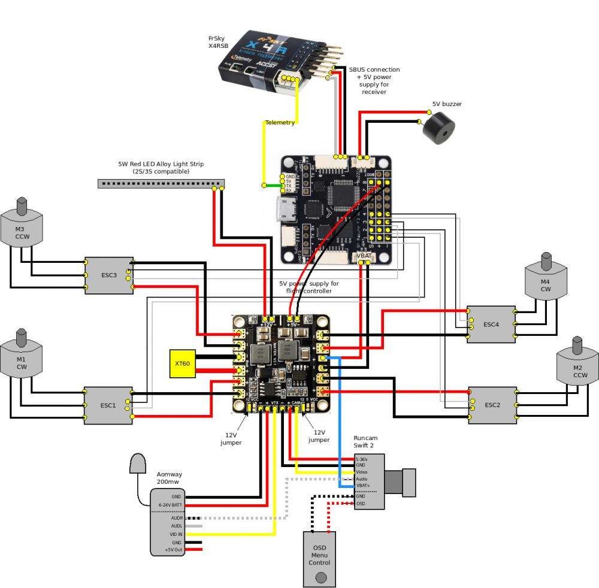
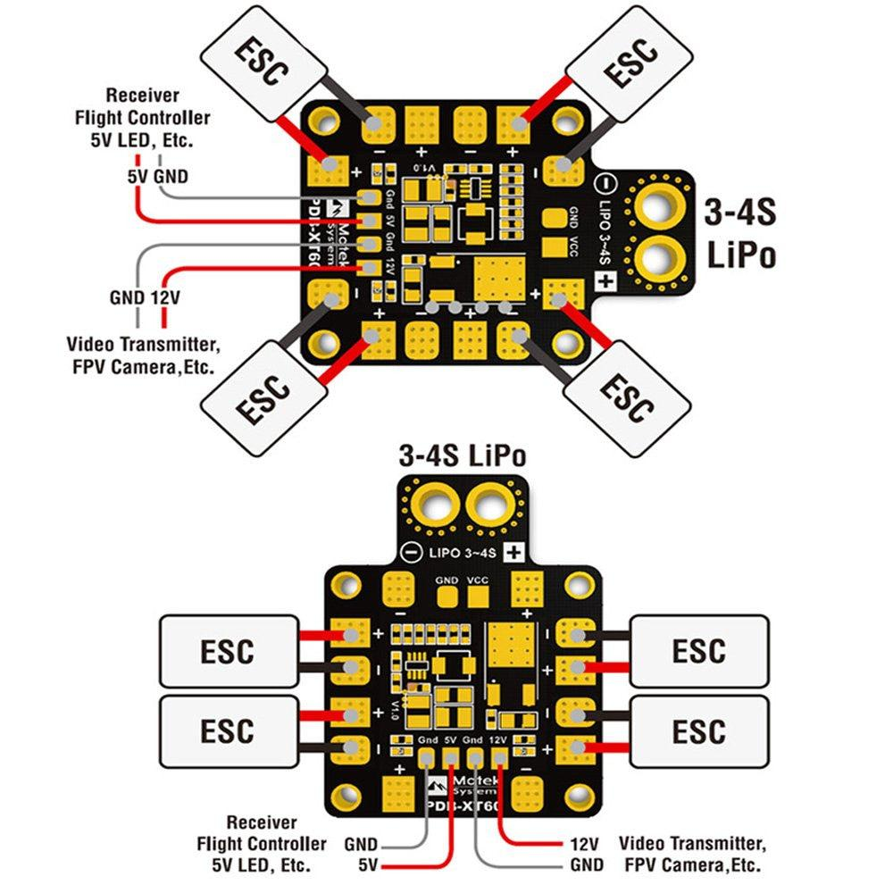
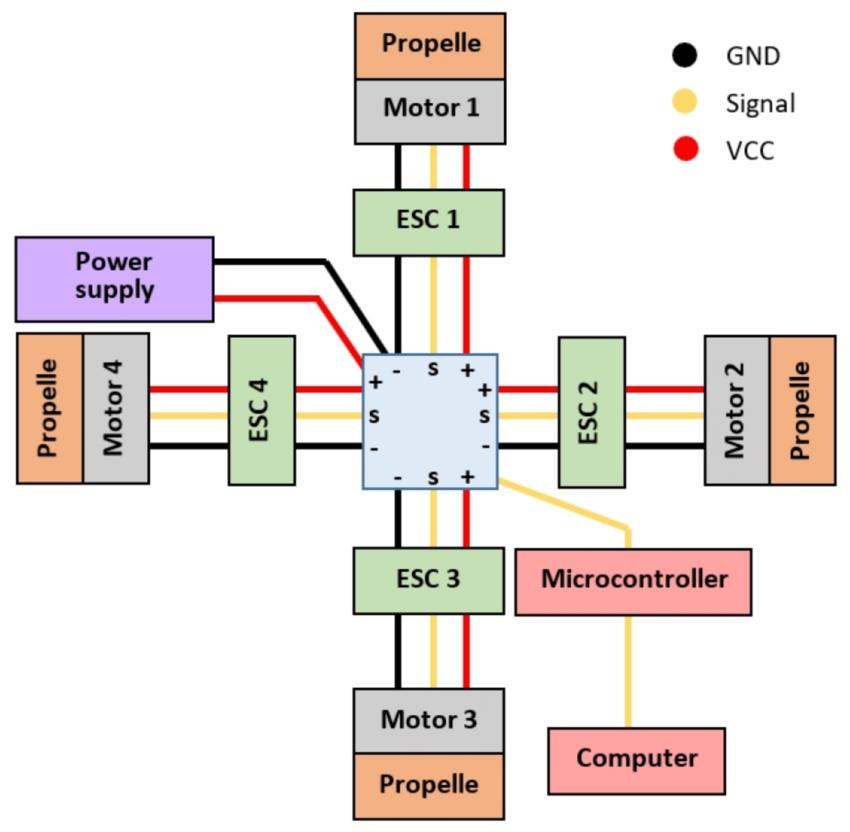

# UAV Electrical Wiring Diagrams

## Overview

This folder contains the electrical connection diagrams and system architecture documentation for the Radiolink Crossflight V1.0 quadcopter.

## Planned Documentation

### 1. Power Distribution Architecture

Illustrates the electrical power flow from the 4S LiPo battery to the propulsion system and onboard electronics.

### 2. ESC and Motor Connections

Documents the connections between the Electronic Speed Controllers and brushless DC motors.

### 3. Flight Controller Connections

Documents the interfaces between the flight controller, ESCs, RC receiver and GPS module.

## Engineering Objectives

* Understand UAV electrical architecture.
* Document component connectivity.
* Visualise power and signal distribution.
* Maintain clear technical documentation.

## Notes

Diagrams will be based on the actual hardware configuration and verified electrical connections of the assembled quadcopter.

# UAV Electrical Wiring Diagrams

## 1. UAV Electrical Architecture

---

## 2. Flight Controller Connections

---

## 3. UAV Propulsion System

